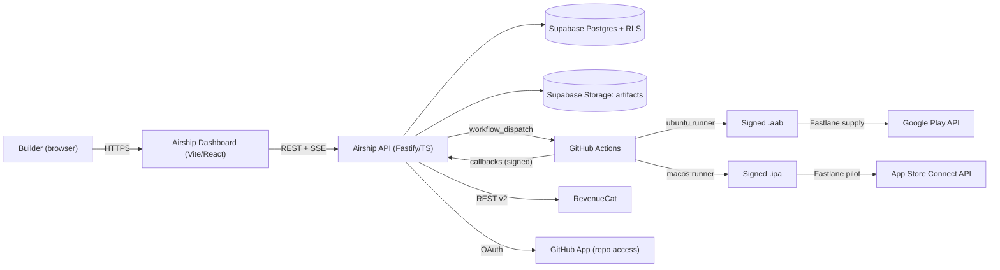
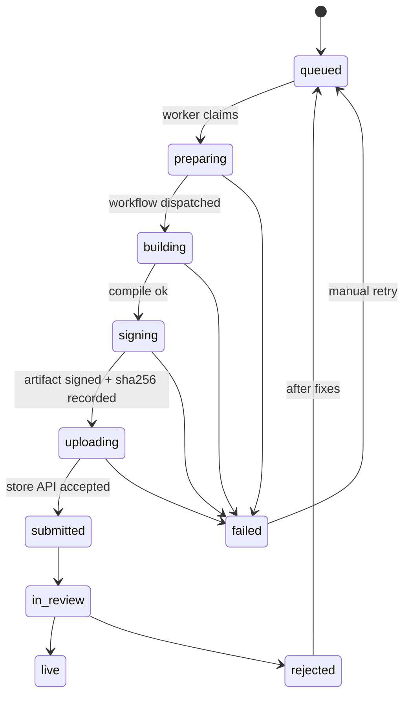

# AIRSHIP: ARCHITECTURE SPECIFICATION
*Governed by [constantprompt.md](../.constantprompt/constantprompt.md). Where this document and the constantprompt disagree, the constantprompt wins.*

Items marked **[VERIFY]** depend on third-party API behavior I could not confirm from this workspace. Each one is verified during the phase named in its note, before any code depends on it.

---

## 1. System Context



**Trust boundaries**
1. **Browser:** the only place a customer vault key exists in plaintext (Rule 7).
2. **API:** sees ciphertext, metadata, and job state. It never sees plaintext store credentials in attended mode.
3. **Ephemeral runner:** receives credentials re-encrypted to its one-time key, uses them, and is destroyed.

---

## 2. Components

| Component | Responsibility | Tech |
| :--- | :--- | :--- |
| Dashboard | Wizard UI, live build log, vault unlock, store connections, 4-target deployer | Vite, React, TS, Zustand, Vanilla CSS |
| API | Auth, projects, job queue, store publisher, web deployer, disk persistence | Node, TS, Fastify, Zod |
| Artifact Engine | Authentic 2048-bit RSA-SHA256 package signer & asset bundler | Node crypto, PKZIP, Buffer |
| Remediator | In-place disk repair of Apple 4.2, 5.1.1(v) deletion, and privacy docs | Node fs, path, Shield API |
| Publisher | Live Google Play Android Publisher v3 OAuth2 client, Cloudflare Pages, Netlify | Fetch, JWT RS256, Wrangler CLI |
| Build templates | Parameterized workflows and Fastlane lanes copied into customer builds | YAML + Ruby (Fastfile) |
| Shield | Static scan of the web app + native capability injector | TS services |
| Vault client | Key derivation, encrypt/decrypt, per-job re-encryption (PBKDF2 600k) | Web Crypto |
| MCP server | Exposes pipeline as 8 tools per Rule 12 | TS, MCP SDK |

---

## 3. Data Model (Postgres, RLS on every table, owner = `auth.uid()`)

```
users               id, email, created_at
projects            id, owner_id, name, bundle_id, source_type(url|github|zip),
                    source_ref, web_dir, status, created_at
brand_assets        id, project_id, kind(icon|splash|screenshot), storage_path, meta
store_connections   id, owner_id, store(play|apple|revenuecat), label,
                    ciphertext, wrapped_dek, kdf_params, created_at, revoked_at
builds              id, project_id, platform(android|ios), version_name,
                    version_code, state, gh_run_id, artifact_path, sha256,
                    started_at, finished_at, error_code
build_events        id, build_id, ts, level, message   -- redacted log lines only
submissions         id, build_id, store, track(internal|closed|production|testflight),
                    state(queued|uploaded|in_review|rejected|live|failed),
                    store_ref, reject_reason, updated_at
compliance_reports  id, project_id, score, findings(jsonb), created_at
monetization        id, project_id, rc_project_id, products(jsonb), ads_enabled
vault_audit         id, owner_id, connection_id, build_id, action, ts
```

Rules: `store_connections.ciphertext` is the only place credentials live. `build_events` messages pass through the redactor before insert. `vault_audit` is append-only.

---

## 4. Build Job State Machine



- Every transition writes a `build_events` row.
- UI shows **"Published" only on `live`** (Section VII.6 of the constantprompt). `submitted` and `in_review` are displayed as such.
- Idempotency: `(project_id, platform, version_code)` is unique. A retry never double-uploads the same version code.

---

## 5. API Surface (v1)

| Method | Route | Purpose |
| :-- | :-- | :-- |
| POST | `/projects` | Create from URL / GitHub / ZIP |
| GET | `/projects/:id` | Project + latest builds + compliance score |
| POST | `/projects/:id/brand` | Upload icon (1024px master), splash |
| POST | `/projects/:id/compliance/scan` | Run Shield |
| POST | `/projects/:id/builds` | Start build `{platform, track}` |
| GET | `/builds/:id/stream` | SSE live redacted log |
| POST | `/store-connections` | Store ciphertext from browser |
| DELETE | `/store-connections/:id` | Revoke and purge |
| POST | `/projects/:id/monetization/provision` | Create RC offerings from store products |
| POST | `/hooks/github` | Signed callback from workflow |
| POST | `/hooks/revenuecat` | Subscription events (post-MVP use) |

All bodies validated with Zod. All routes require auth except the two signed webhooks.

---

## 6. Vault Cryptography (Rule 7 made concrete)

**Storing a credential (browser)**
1. User sets a vault passphrase. Derive `KEK` via Argon2id (or PBKDF2-SHA256 at 600k+ iterations if Argon2id WASM is unavailable). Params stored in `kdf_params`.
2. Generate random 256-bit `DEK` per connection. Encrypt the credential with AES-256-GCM (random 96-bit IV, never reused). Wrap `DEK` with `KEK`.
3. Upload `ciphertext` and `wrapped_dek`. The server cannot decrypt either.

**Using a credential in a build (attended mode, default)**
1. The workflow's runner generates an **ephemeral X25519 keypair** and posts its public key to the API for that job.
2. The dashboard (vault unlocked) unwraps the `DEK`, decrypts the credential, **re-encrypts it to the runner's public key**, and posts that envelope.
3. The runner decrypts it in memory, writes it to a tmpfs file, runs Fastlane, then shreds the file. The runner VM is destroyed afterward.

**Tradeoff, stated plainly:** attended mode requires the customer's browser session at build time. It cannot support "auto-build on git push" without the customer present.
**Unattended mode (opt-in, Phase 5):** the customer explicitly authorizes a server-side KMS-wrapped copy. This weakens the zero-knowledge guarantee and the UI must say so in plain language before the customer enables it.

**Redaction:** a single `redact()` function is applied to every log line before storage. It masks anything matching the known credential patterns and every byte sequence of secrets loaded for the job. Unit tests feed it real-format fake secrets.

---

## 7. Build Pipeline (GitHub Actions)

**Where builds run:** Airship's own GitHub org with one private repo per customer project ("build repo"), created and populated by the GitHub App. Customer source is pulled from their repo or ZIP into the build repo at job start. This keeps customer code isolated and workflow templates under our control.

**Android workflow (`ubuntu-latest`)**
```
checkout build repo
setup-node, setup-java 17
npm ci && npm run build
npx cap sync android
decrypt upload keystore envelope (tmpfs)
./gradlew bundleRelease  (signing config read from env, not committed)
sha256 + upload artifact to Supabase Storage
callback -> API (state=signing->uploading)
fastlane supply --aab ... --track <internal|closed|production>
callback -> API (submitted)
```

**iOS workflow (`macos-latest`)**
```
checkout, setup-node, npm ci && npm run build
npx cap sync ios
pod install
App Store Connect API key (.p8) from envelope
xcodebuild archive with automatic signing via API key (-allowProvisioningUpdates + authenticationKey flags)
xcodebuild -exportArchive -> .ipa
fastlane pilot upload (TestFlight)
callback -> API
```

**Cost control:** macOS runner minutes are billed at a multiple of Linux minutes on GitHub. The pricing model must include this cost. Cache `node_modules`, Gradle, and Pods. **[VERIFY in Phase 2: actual macOS multiplier and per-build minutes, then price accordingly.]**

---

## 8. Store Bridge Specifics

**Google Play (`androidpublisher v3`)**
- Flow: create edit, upload bundle, assign to track, commit. Handled through Fastlane `supply`.
- Customer must create the app in Play Console and invite the service account with release permissions. **[VERIFY Phase 0/1: whether a first release must be done manually before API uploads succeed for a brand-new app.]**
- Listing declarations (data safety, content rating, target audience) are completed in Play Console. Airship generates the answers and shows them for copy; it does not claim to submit them. **[VERIFY: current API coverage.]**
- Personal-account 12-tester / 14-day closed test is tracked as a checklist item (Constantprompt III.4).

**Apple (App Store Connect API)**
- Auth: ES256 JWT signed with the `.p8`, plus key ID and issuer ID.
- **App record creation:** the public API does not create new app records as far as I know; Fastlane `produce` uses an Apple ID session with 2FA. Plan assumes the customer creates the app record manually (guided, with the exact bundle ID and name pre-filled for copy). **[VERIFY Phase 2.]**
- Builds go to TestFlight via `pilot`. Metadata and screenshots via `deliver`.
- Review submission state is polled and mapped to `submissions.state`.

**RevenueCat (REST v2)**
- Order matters: products must exist in each store first, then RevenueCat apps, products, entitlements, offerings and packages are created. **[VERIFY Phase 4: exact v2 endpoint coverage for each object.]**

---

## 9. Compliance Shield

| Check | Method | Output |
| :-- | :-- | :-- |
| Native capability (4.2) | Scan for installed Capacitor plugins and usage in code | Score + list of missing capabilities with one-click inject |
| Account deletion | Detect signup flow; look for delete-account route/UI | Pass/fail + generated flow template |
| Privacy policy | Detect network calls, SDKs, permissions; generate policy from findings | Hosted policy URL + diff against detected behavior |
| Billing path | Detect Stripe/web checkout for digital goods | Warn (3.1.1) |
| Permissions | Manifest/Info.plist usage strings vs. actual plugin use | Missing/unused permission list |
| Assets | Icon dimensions, alpha channel (iOS rejects alpha), screenshot sizes | Pass/fail per asset |

Findings carry severity and a plain-language explanation. The Shield **advises**. It never promises approval.

---

## 10. Repository Layout (`I:\.genieflowai.brain\03_APPS\airship\`)

```
.constantprompt/constantprompt.md
docs/ARCHITECTURE.md, PHASE_PLAN.md, partner-approvals/
apps/dashboard/        Vite React app
apps/api/              Fastify API + worker
packages/shield/       compliance scanners
packages/vault/        Web Crypto helpers (shared browser/runner)
packages/mcp/          MCP server
templates/android/     workflow + Fastfile
templates/ios/         workflow + Fastfile
supabase/migrations/
.github/workflows/     Airship's own CI
```

---

## 11. Environments & Ops

- **Environments:** `local`, `staging` (Syncura fixture runs here), `prod`.
- **Observability:** structured JSON logs (redacted), build duration and failure-code metrics, alert on queue age and on any redactor miss.
- **Backups:** daily Postgres backup; artifact retention 90 days.
- **Abuse controls:** per-user build quotas, repo size caps, network egress limits on runners, no customer-supplied code executes on API hosts.
- **Legal surface (must exist before beta):** Terms of Service, Privacy Policy, and a data-processing statement covering credential custody.

---

## 12. Known Unknowns (resolved by phase)

| # | Question | Resolved in |
| :-: | :-- | :-: |
| 1 | Play: manual first release required for new apps? | 0 |
| 2 | Play: API coverage for listing declarations | 1 |
| 3 | Apple: app record creation path | 2 |
| 4 | GitHub macOS minute multiplier and real build time | 2 |
| 5 | RevenueCat v2 endpoint coverage | 4 |
| 6 | Argon2id WASM performance on low-end mobile browsers | 3 |
